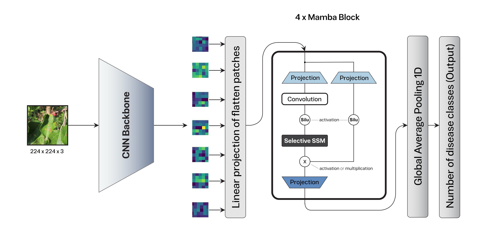

# PlantXMamba

Official code for the paper **[A Hybrid CNN–State Space Model with Systematic Design Analysis for Efficient Plant Disease Recognition](https://bit.kuas.edu.tw/~jihmsp/2026/vol17/N3/JIHMSP_2026_vol17_n3_009.pdf)** (JIHMSP, 2026).

PlantXMamba combines a lightweight VGG16 backbone for local feature extraction with Mamba blocks for long-range context modeling in plant disease recognition.

## Architecture



| Stage | Output |
| --- | --- |
| Input RGB image | 3 × 224 × 224 |
| First two VGG16 blocks (ImageNet-pretrained) | 128 × 56 × 56 |
| Patch embedding, 5 × 5 patches | 121 tokens × 16 |
| 4 Mamba modules (2 Mamba layers each) | 121 × 16 |
| LayerNorm → global average pooling → linear | class logits |

| Parameters | GFLOPs | Weights (float32) |
| ---: | ---: | ---: |
| 0.47M | 4.73 | 1.79 MB |

## Quick start

Run from the repository root. The CPU example was checked with Python 3.13, PyTorch 2.9.1, and TorchVision 0.24.1.

```bash
python -m pip install -r requirements.txt
```

```python
import torch
from plantxmamba import PlantXMamba

model = PlantXMamba(num_classes=38, pretrained=False).eval()
x = torch.randn(1, 3, 224, 224)
with torch.inference_mode():
    logits = model(x)
print(logits.shape)  # torch.Size([1, 38])
```

This example checks the forward pass with random input and untrained weights. The repository provides the model architecture. The training pipeline, datasets, and trained checkpoints are not included. See the paper for the experimental protocol.

## Accuracy reported in the paper

| Dataset | Classes | Accuracy |
| --- | ---: | ---: |
| Apple (Plant Pathology 2020) | 4 | 95.99% |
| Maize | 4 | 96.50% |
| Rice | 5 | 98.33% |
| Embrapa | 93 | 89.34% |
| PlantVillage | 38 | 98.76% |

## Citation

```bibtex
@article{le2026plantxmamba,
  title   = {A Hybrid {CNN}--State Space Model with Systematic Design Analysis
             for Efficient Plant Disease Recognition},
  author  = {Phan Le, Huy and Nguyen Chi, Hieu and Nguyen Huu, Tuan and Dao Thi Thuy, Quynh},
  journal = {Journal of Information Hiding and Multimedia Signal Processing},
  year    = {2026},
  volume  = {17},
  number  = {3},
  pages   = {539--553},
  url     = {https://bit.kuas.edu.tw/~jihmsp/2026/vol17/N3/JIHMSP_2026_vol17_n3_009.pdf}
}
```

GitHub also shows a "Cite this repository" button generated from `CITATION.cff`.

## Acknowledgements

The Mamba implementation is adapted from Alexandre TL's [mamba.py](https://github.com/alxndrTL/mamba.py), distributed under the MIT License (see [THIRD_PARTY_NOTICES.md](THIRD_PARTY_NOTICES.md)).
